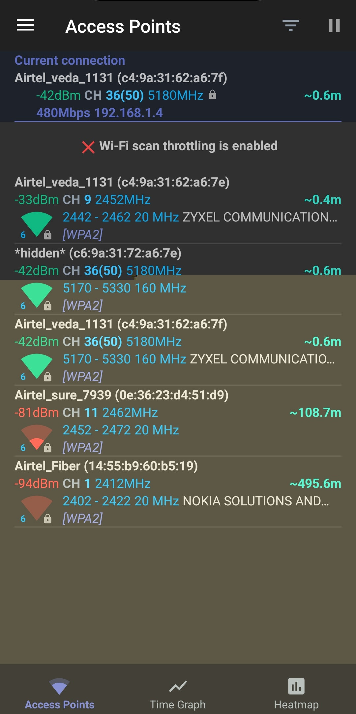
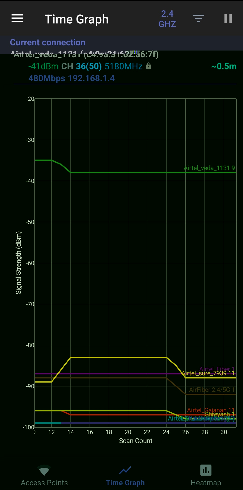
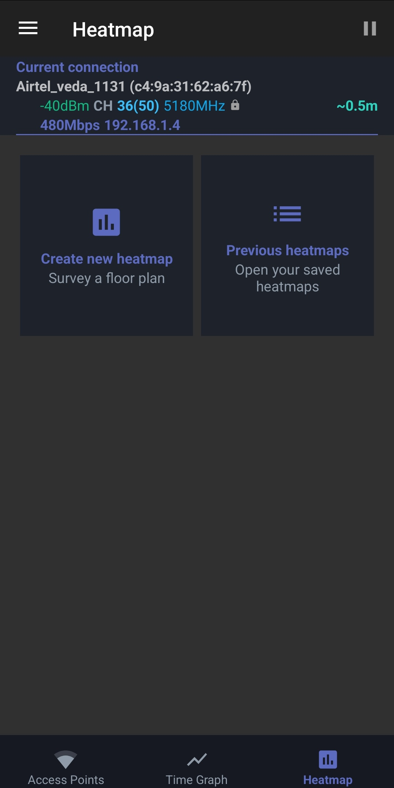
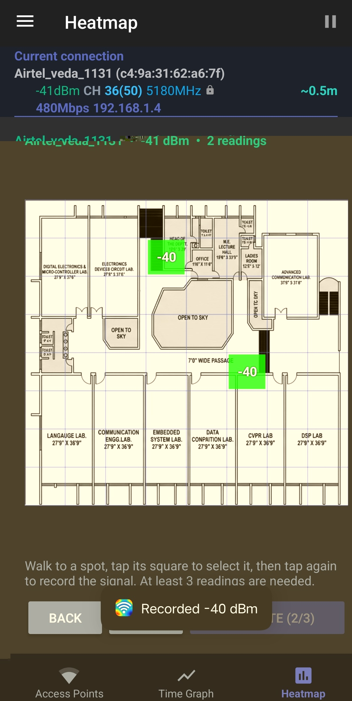
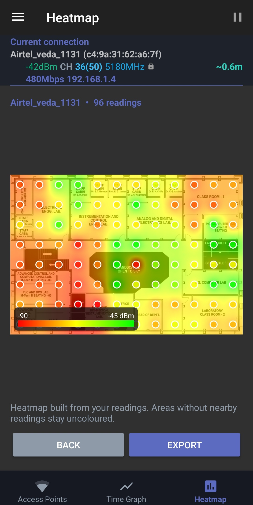

# 📡 Wi-Fi Deadzone Mapper & Analyzer

[](https://developer.android.com/)
[](https://kotlinlang.org/)
[](LICENSE)
[](https://github.com/VREMSoftwareDevelopment/WiFiAnalyzer)

An open-source Android tool designed to survey indoor Wi-Fi signal coverage, identify dead zones, and run access point diagnostics. Import any building floor plan, sample real-time signal strength (RSSI) on a coordinate grid, and generate smooth Inverse Distance Weighting (IDW) heatmaps.

---

## 📥 Direct Download

Ready-to-use debug APK for testing:

👉 **[Download WiFiDeadzone-v1.0.apk]([[https://github.com/Vardhit-08/WIFI_deadzone/releases/download/v1.0.0/WiFiDeadzone-v1.0.apk](https://github.com/Vardhit-08/WIFI-deadzone-mapper/releases/download/v1.0.0/WiFiDeadzone-v1.0.apk)](https://github.com/Vardhit-08/WIFI-deadzone-mapper/releases/download/v1.0.0/WIFI.deadzone.mapper.apk))** 👈

---

## 📸 Screenshots

| 1. Access Points | 2. Time Graph | 3. Heatmap Tab |
|:---:|:---:|:---:|
|  |  |  |

| 4. New Heatmap Generation | 5. Previous Heatmaps |
|:---:|:---:|
|  |  |

---

## ✨ Features

* 🗺️ **Floor Plan Survey Mapping**:
  * Import floor plans from device storage via Android's modern photo picker (no broad file permissions required).
  * Select custom grid square density (**Small**, **Medium**, **Large**).
  * Tap once to select a cell; tap again to sample live RSSI. Tap any recorded cell twice to delete and retake.
* 🧮 **IDW Spatial Interpolation Engine**:
  * Uses Inverse Distance Weighting ($w = 1/d^2$) over a 2.5-cell influence radius with soft alpha falloff.
  * Areas outside the sample radius remain uncolored and neutral, preventing false deadzone artifacts.
  * Dynamic gradient scale from **-90 dBm (Red)** to **-45 dBm (Green)** with an on-screen reference legend.
* 💾 **Persistence & Redraw**:
  * Saves lightweight JSON coordinate measurements and floor plan images locally in private storage.
  * Recalculates and redraws maps dynamically when re-opened from **Previous Heatmaps**.
* 🖼️ **Gallery Export**:
  * Exports high-resolution composite PNGs directly to `Pictures/WiFiHeatmap`.
* 📊 **Wi-Fi Diagnostics**:
  * Real-time signal strength, channel ratings, frequency bands (2.4 GHz, 5 GHz, 6 GHz), and time-graph tracking.

---

## 📲 Installation & Prerequisites

1. Download the APK directly on your device.
2. Tap the APK to install. When prompted, permit **Install from Unknown Sources**.
3. **Required Device Settings**:
  * **Location Permission (While using the app)**: Mandatory by the Android operating system to scan nearby Wi-Fi APs and read RSSI values.
  * **Location / GPS**: Keep enabled while conducting surveys.
  * *(Recommended)*: Disable **Wi-Fi scan throttling** in Android *Developer Options* to allow continuous real-time signal sampling.

---

## 🛠️ Tech Stack & Architecture

* **Language**: 100% Kotlin
* **UI Framework**: Android Jetpack, ViewBinding, Custom Canvas graphics (`HeatmapCanvasView`)
* **Algorithm**: Inverse Distance Weighting (IDW) interpolation (`HeatmapIdw.kt`)
* **Min SDK**: API 26 (Android 8.0) | **Target SDK**: API 34 (Android 14)

---

🙏 Acknowledgments & Upstream Attribution
This project is built upon the open-source foundation of WiFiAnalyzer by VREM Software Development, distributed under the GNU General Public License v3.0.

All upstream core diagnostic tools (Access Points, Signal Meters, Channel Graphs) belong to the original contributors, with custom extensions added for indoor survey mapping, IDW spatial rendering, and persistence.

📄 License
This project is open-source under the GNU General Public License v3.0.

## 💻 Building from Source

```bash
# Clone the repository
git clone [https://github.com/Vardhit-08/WIFI_deadzone.git](https://github.com/Vardhit-08/WIFI_deadzone.git)
cd WIFI_deadzone

# Run IDW math unit tests
./gradlew testDebugUnitTest --tests "*HeatmapIdwTest"

# Build debug APK
./gradlew assembleDebug

# Install to connected device over USB
./gradlew installDebug

